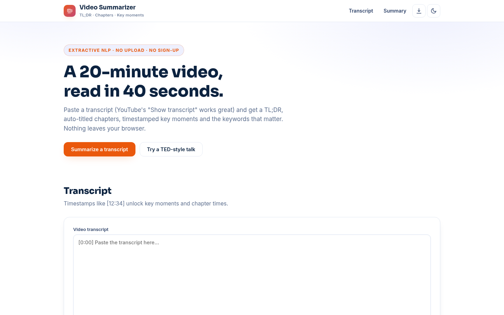

# Video Summarizer — Transcripts to TL;DR, Chapters & Key Moments

**Live:** https://akash991833.github.io/video-summarizer/

Paste a video transcript and get a TL;DR, auto-titled chapters, timestamped key moments and the keywords that matter — instantly, in your browser. YouTube's "Show transcript" copies straight in. No upload, no sign-up, no API key.



## Features

- **TL;DR** — the five highest-value sentences, in original order
- **Chapters** — the video split into sections, each auto-titled by its top keywords with a representative sentence
- **Key moments** — timestamped highlights, spaced apart so they cover the whole video
- **Keyword cloud** — the terms that carry the content
- **Timestamp parsing** — understands `[mm:ss]`, `mm:ss` and `h:mm:ss` markers
- **Export** — the full summary as Markdown
- **Two samples** — a TED-style science talk and a coding tutorial
- **PWA** — installable, works fully offline
- **Dark & light themes**, responsive on mobile and desktop

## How it works

1. **Parse** — transcript lines become timestamped segments, then sentences
2. **Keywords** — stopword-filtered term frequency finds the load-bearing words
3. **Scoring** — sentences ranked by keyword density with a brevity bonus
4. **Selection** — TL;DR takes the top sentences in order; moments enforce a minimum time gap; chapters title equal blocks by their local keywords

## Honest limits

Extractive summarization: sentences are selected, never rewritten or fact-checked. It cannot watch the video — visual demos, slides and demos are invisible. Auto-captions with errors produce summaries with errors. Very short or timestamp-free transcripts get fewer features (no key moments). English only.

## Tech

Vanilla HTML/CSS/JS. No build step, no backend, no tracking.

## Run locally

```bash
python3 -m http.server 8000
# open http://localhost:8000
```

Built by [Akash Vishwakarma](https://github.com/AKASH991833). Free to use — no sign-up, no card.


## Stacks

- **Live demo (this repo root):** HTML/CSS/JS — browser shot detection and Web Speech transcription.
- **Python pipeline (`python/`):** PySceneDetect + faster-whisper + OpenCV keyframes for real scene detection and real transcription. See `python/README.md`.
